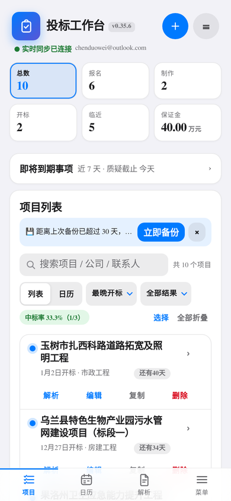
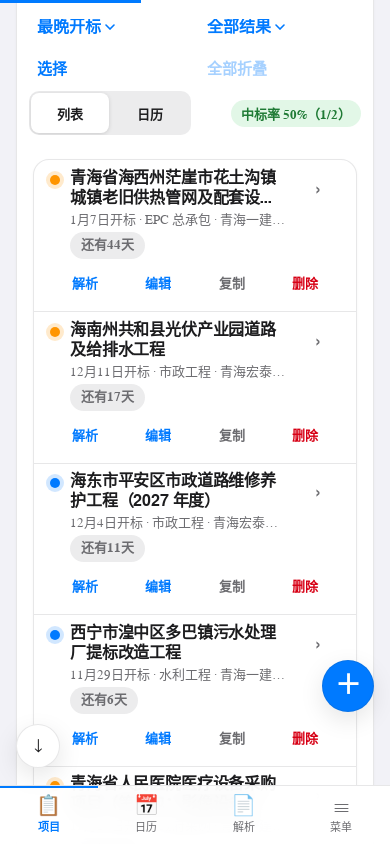

# 📋 投标工作台

> 面向工程建设标书人员的投标工作台：项目与多截止提醒、开标日历、保证金台账、废标检查清单，
> 招标文件在浏览器内解析、由 AI 抽出带页码原文的风险与资格要求。

[](https://github.com/chenduowei/ai-bid-assistant/actions/workflows/ci.yml)
[线上地址](https://chenduowei.vercel.app/) · [更新记录](docs/changelog.md) · [维护说明](docs/notes.md)

当前版本：**v0.37.0**





## ✨ 能做什么

- **🗂️ 项目管理**：开标日期与时刻（时刻选填，倒计时可精确到小时）、项目类型、投标公司、招标单位、联系人、保证金、项目金额、状态与备注；详情区点一下即改状态。
- **⏰ 多截止与临期提醒**：报名、质疑、澄清、保证金缴纳四个截止日期，与开标日一起进入「即将到期事项」面板与浏览器通知。
- **🏁 中标结果与中标率**：开标后记「已中标 / 未中标」，列表可按结果筛选，工具栏直接算中标率。
- **📄 招标文件解析**：PDF 在浏览器本地解析，文件本身不上传。AI 抽取开标时间、资格要求、废标条款与风险点，**每条带页码原文**，逐条可核对。
- **↩️ 回填表单**：分析结果核对后回填到项目表单，确认后保存；解析原文随表单一并存入，之后可直接查看，不用重新传文件。
- **🏅 我的资质**：录入企业施工资质、安全生产、注册人员、业绩，AI 分析时**逐条对照**资格要求，给出 ✓ 满足 / ✗ 缺失 / ? 待确认 与一句话依据。
- **💰 保证金台账与废标清单**：保证金按金额、单位与缴纳状态记账，在途金额单独统计、可一键标记退回；AI 抽出的废标条款可转成逐项勾选的检查清单。
- **📅 开标日历与系统日历订阅**：月历视图按紧急度标点；「日历订阅」生成一条 .ics 链接，同步到手机系统日历，每个项目在开标前一天 9 点、当天 8 点各提醒一次（关页也有效）。
- **🔄 数据进出**：CSV / Excel 导入（自动去重）、CSV 导出、一键备份与恢复（默认不含招标全文，可勾选包含）、导入模板。
- **🖥️ 电脑端工作台**：宽屏下是「左侧项目列表 + 右侧信息栏」的两栏版式——一屏就能看到 5 张项目卡（1440×900 首屏首卡 592px，此前要滚到 1082px），临期事项竖排、不再横向裁切；新增 / 编辑展开后表单铺满整行、字段三列排布；项目详情是两列定义列表；工具栏、提示条、抽屉标题栏都按桌面重新排过，图标统一成一套单色线性图标。
- **🎛️ 原生质感（v0.37.0）**：按 Apple HIG 收过一遍——`#F5F5F7` 画布 + 白卡 + 0.06 hairline、全站只用一支系统蓝；顶栏是吸顶毛玻璃应用栏，手机底栏与桌面抽屉标题栏同一档 `blur(20px) saturate(180%)`；列表/日历切换与项目状态是 iOS 分段控件，搜索框是填充灰；彩色只留给倒计时、等级与状态胶囊，风险、清单、临期卡片一律中性底；标题字重降一档、数字等宽（`tabular-nums`）。
- **📱 手机可用**：可装到桌面（PWA），断网时展示最近一次同步的只读快照，联网自动恢复。竖屏下项目名两行整行显示（第三行字头不再露头）、倒计时与开标日排在同一行、操作条轻量（卡片 127px，一屏三张），「即将到期」与标题并成一行摘要点开看横条，底部导航是一套单色图标，顶栏标题旁能看到当前版本号；展开详情的废标检查清单默认收起成一条进度（`已完成 1/3`），长项目名在详情里完整折行显示，风险与条款的「核对 / ×」在同一行成组对齐。

## 🔒 数据去向与边界

- PDF **文件本身**在浏览器内解析，不上传。解析文字随表单保存后存入 Supabase（`pdf_text`，截断到 20 万字符），列表平时不拉取全文。
- AI 分析时，解析文字发给**你自己配置的模型服务商**（OpenAI 兼容接口）。API Key 只存在本机 `localStorage`，不经过本项目后端。
- 项目数据存 Supabase，以 Row Level Security 按用户隔离；日历订阅链接带令牌，拿到链接即可**只读**该账户的待开标项目（名称、开标日、类型、公司、联系人、备注），别外传，可随时停用或重新生成。
- 需自备 Supabase、API Key、API Base URL 与模型名，不提供统一模型服务。
- 浏览器通知只在页面打开时生效；关页提醒请用「日历订阅」。
- 扫描版 / 图片 PDF 没有文本层，工具会提示先用 OCR 转文字，暂不内置 OCR。

## 🚀 本地运行

需要 **Node.js 20+**（仅用于生成配置与跑测试，应用本身零构建）。在 [Supabase](https://supabase.com/) 建一个项目，然后在 SQL Editor 里执行 `supabase.sql`（建表、RLS、只读订阅函数，幂等）。

```
git clone https://github.com/chenduowei/ai-bid-assistant.git
cd ai-bid-assistant
cp supabase-config.example.js supabase-config.js   # 填入 Project URL 与 anon key
```

也可以不提交配置文件，改用环境变量：`SUPABASE_URL=… SUPABASE_ANON_KEY=… npm run build` 会生成 `supabase-config.js`。

用任意静态 HTTP 服务器启动（VS Code Live Server 即可）。**不要用 `file://` 直接打开**，ES Modules 需要 HTTP 环境。登录后在 ☰ →「⚙️ 设置」里填写 API Key、Base URL 与模型名，即可用 AI 分析。

| 命令 | 作用 |
| --- | --- |
| `npm test` | 190 个单元/渲染测试（`node --test`，无外部框架） |
| `npm run check:version` | 版本号一致性（package.json / sw.js 缓存名 / 页眉 / README / notes / changelog） |
| `npm run check:css` | 样式表回归校验（丢分号、大括号平衡、同断点重复、**跨断点顺序覆盖**） |
| `npm run build` | 从环境变量生成 `supabase-config.js` |

## ☁️ 部署到 Vercel

导入仓库，Framework 选 Other，Build Command 用 `npm run build`，环境变量加 `SUPABASE_URL` / `SUPABASE_ANON_KEY`。不要把真实密钥提交到 Git（`supabase-config.js` 已在 `.gitignore`）。

在 Supabase Authentication → URL Configuration 里配置 Site URL 与 Redirect URLs（Vercel 地址与本地开发地址）。

**从 v0.34 升级到 v0.35** 需执行一次 `docs/migrations/v0.35.0-bid-time-result.sql`（新增 `bid_time` / `result` 两列并更新订阅函数，幂等）。不执行也能打开：前端会先探测这两列，旧库自动降级，只是「开标时刻 / 中标结果」存不进去（会有提示）。

日历订阅复用上面两个环境变量；另需执行 `supabase.sql` 第 10 节（`calendar_tokens` 令牌表 + 只读函数）后，登录 App 打开「📅 日历订阅」生成链接即可。

## 🗂️ 项目结构

```
index.html / app.js / styles.css   页面入口、状态与事件、样式
js/                                业务模块
  auth.js          登录 / 注册 / 重置密码
  projects.js      数据层（Supabase CRUD、实时增量、备份恢复）
  ui.js            渲染、确认框、焦点陷阱、Toast
  drawers.js       回收站 / 保证金 / 资质 / 日历订阅四个抽屉
  data-io.js       CSV / Excel 导入、导出、备份
  pdf-parser.js    浏览器内 PDF 解析（pdf.js，双源兜底）
  ai-extract.js    分块 + 流式 AI 抽取（带页码原文）
  ics.js           .ics 生成与令牌校验（前后端共用）
  utils.js         纯函数（日期、倒计时、金额、CSV、快照…）
vendor/                            随仓库分发的 supabase-js（CDN 只作兜底）
assets/                            登录页海报
api/calendar.js                    .ics 订阅端点（Vercel Serverless）
tests/                             17 个测试文件 / 190 个用例
supabase.sql                       建表、RLS、安全策略、订阅函数
docs/                              changelog、维护说明、迁移脚本（docs/migrations/）
scripts/                           配置生成、版本与样式校验
.github/workflows/ci.yml           推送自动跑测试 + 两项校验
```

## ❓ 常见问题

**打开是一片空白 / 提示配置缺失？** 没有 `supabase-config.js` 或里面的 URL、anon key 还是占位值。本地按上文复制并填写，Vercel 上检查两个环境变量。

**AI 分析报错？** 先在设置里确认 API Key、Base URL（要能拼成 `{baseUrl}/chat/completions`）与模型名；「输出被截断」说明文档太长，可换更大输出上限的模型或分段分析。

**通知没反应？** 浏览器通知只在页面打开时触发，且需要站点权限（设置 →「开启通知」，必须先点一下按钮，浏览器不接受自动申请）；关页提醒请用日历订阅。

**扫描版 PDF 解析不出文字？** 没有文本层，先自行 OCR 成文字版 PDF 再上传。

**「开标时刻」「中标结果」存不上？** 没执行 `docs/migrations/v0.35.0-bid-time-result.sql`。执行一次即可，幂等，可重复跑。

## License

[MIT](LICENSE)
