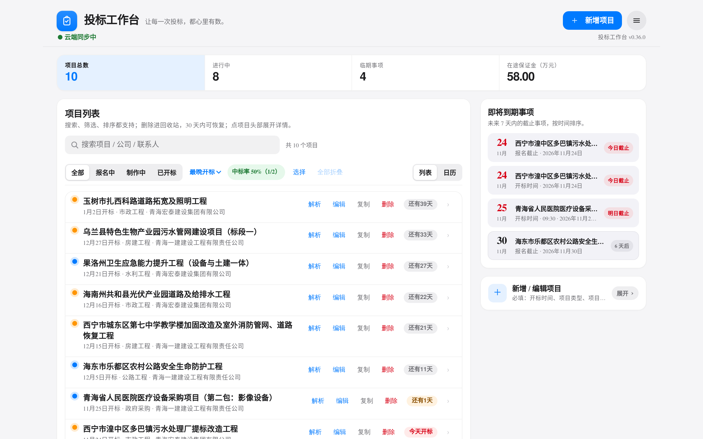
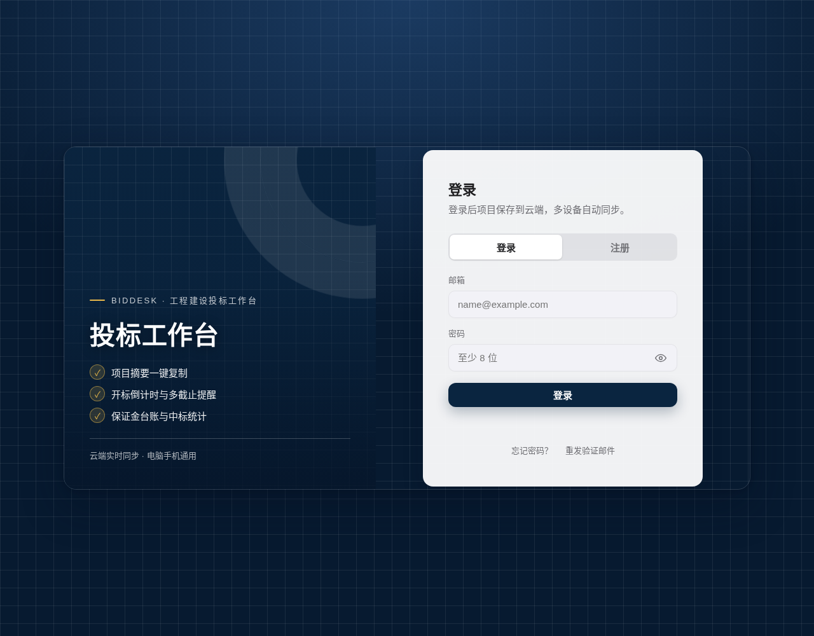

# 📋 投标工作台 · BidDesk

> 帮你把工程投标管在一个地方：项目、开标时间、保证金，一个都不少。

## ✨ 能帮你做什么

- 🗂️ **项目台账**：报名中 / 制作中 / 已开标，一眼看清每个项目到哪一步了
- ⏰ **开标倒计时**：打开就看到最近一场开标还有多久，再也不怕错过时间
- 🔔 **临期提醒**：报名、质疑、澄清、保证金、开标，未来几天要办的事都列好
- 📅 **日历**：开标日排得明明白白，还能同步到手机系统日历
- 💰 **保证金**：在途、待退还各有多少钱，随时能查
- 📋 **一键复制摘要**：项目信息一键复制，粘贴就能发
- 🔄 **导入导出 / 备份**：Excel 导进来，备份导出去，换设备也不丢

## 🖼️ 截图

| 登录页（桌面） | 主界面（手机） |
| --- | --- |
|  |  |

更多截图见 [`docs/screenshots/`](docs/screenshots/)。

## 🚀 怎么用

在线看看：<https://chenduowei.vercel.app/>（打开是登录页）

想自己搭一个：

1. 复制 `supabase-config.example.js` 为 `supabase-config.js`，填上你自己的 Supabase 地址和 key
2. 在 Supabase 里执行一次 `supabase.sql` 建表
3. 用 Vercel 部署，或者本地用静态服务器打开

数据存在你自己的 Supabase 里，别人看不到。

---

当前版本 v0.55.1
